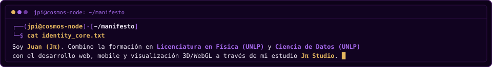
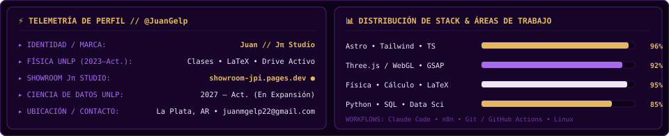

<!-- HEADER PRINCIPAL: ARTE ASCII 3D EN TIEMPO REAL & STARFIELD -->

 

<!-- TERMINAL ANIMADA EN DORADO (#e5b75f) -->

 

<!-- BOTONERA DE ACCESO RÁPIDO -->

 

---

## `⚡ // MANIFIESTO: JUAN // Jπ STUDIO`

  

---

## `🪐 Licenciatura en Física — UNLP`

**Licenciatura en Física UNLP (2023 - Act.)** • Asesoramiento y Clases de Consulta Particulares • Cursos de `LaTeX` para Confección de Papers Científicos.

  

  

 

---

## `🚀 Desarrollo Web - Jπ Studio`

Desarrollo web y mobile a medida, experiencias interactivas **3D / WebGL**, motion design y automatización de flujos con IA.
- **Qué ofrezco:** Diseño y desarrollo de sitios web de alto impacto, landings interactivas, prototipos de aplicaciones móviles, visualizadores 3D en tiempo real y automatización de procesos.
- **Herramientas que utilizo:** `Astro` • `Tailwind CSS` • `TypeScript` • `Three.js / WebGL` • `GSAP` • `Lenis` • `Rive` • `Claude Code` • `n8n`.

  
  

  

 

---

## `📊 Ciencia de Datos — UNLP`

### **Ciencia de Datos en Organizaciones UNLP (2027 - Act.)**

Espacio en construcción donde iré documentando apuntes, modelos estadísticos, notebooks y proyectos de la carrera.
- **Herramientas & Stack de Carrera:** `Python` • `SQL` • `Pandas` • `NumPy` • `Jupyter / Google Colab` • `Estadística & Probabilidad` • `Modelado & Visualización de Datos` • `LaTeX`.

  

  

 

---

## `🛠️ // HERRAMIENTAS & STACK TÉCNICO`

| **Desarrollo Web & Motion (Jπ Studio)** | **3D, Shaders & AI Workflows** | **Física, Matemática & Ciencia de Datos (UNLP)** |
| :---: | :---: | :---: |
|  |  |  |
|  |  |  |
|  |  |  |
|  |  |  |
|  |  |  |

 

---

## `📊 // TELEMETRÍA & ESTADO DEL SISTEMA (JuanGelp)`

  

