<!-- HEADER PRINCIPAL: EDGE ORBIT & Jπ DORADO EN EL CENTRO -->

  

<!-- LINKS DE CONTACTO SIMPLIFICADOS EN UN SOLO RENGLÓN -->

  &nbsp;
  &nbsp;
  &nbsp;
  

---

## `🪐 Licenciatura en Física — UNLP`

- **Licenciatura en Física UNLP (2023 - Act.)**
- **Asesoramiento y Clases de Consulta Particulares**
- **Cursos de `LaTeX` para Confección de Papers Científicos**

  

  

 

---

## `🚀 Desarrollo Web - Jπ Studio`

- **Qué ofrezco:** Desarrollo web y mobile de autor, experiencias interactivas **3D / WebGL**, motion design, landings de alto impacto y automatización de flujos con IA.
- **Herramientas que utilizo:** `Astro` • `Tailwind CSS` • `TypeScript` • `Three.js / WebGL` • `GSAP` • `Lenis` • `Rive` • `Claude Code` • `n8n`.

  
  

  

 

---

## `📊 Ciencia de Datos — UNLP`

- **Ciencia de Datos en Organizaciones UNLP (2027 - Act.)**
- **Espacio en construcción:** Repositorio donde iré documentando apuntes, modelos estadísticos, notebooks y proyectos de la carrera.
- **Herramientas & Stack:** `Python` • `SQL` • `Pandas` • `NumPy` • `Jupyter / Google Colab` • `Estadística & Probabilidad` • `Modelado & Visualización de Datos` • `LaTeX`.

  

  

 

---

## `🛠️ // HERRAMIENTAS & STACK TÉCNICO`

| **Desarrollo Web & Motion (Jπ Studio)** | **3D, Shaders & AI Workflows** | **Física, Matemática & Ciencia de Datos (UNLP)** |
| :---: | :---: | :---: |
|  |  |  |
|  |  |  |
|  |  |  |
|  |  |  |
|  |  |  |

