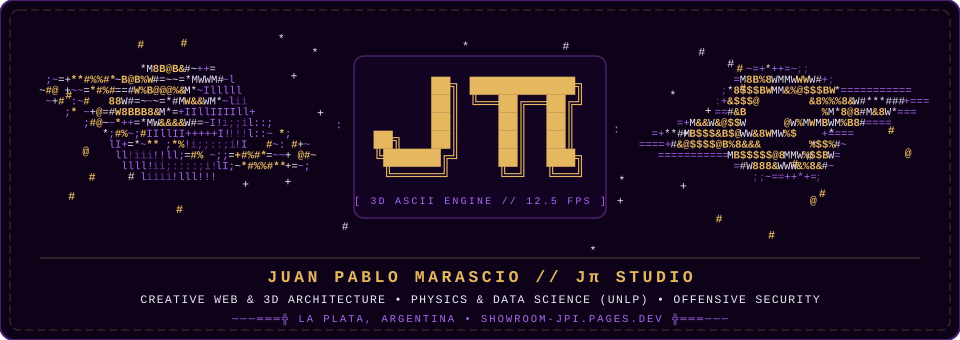
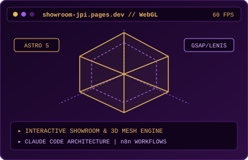
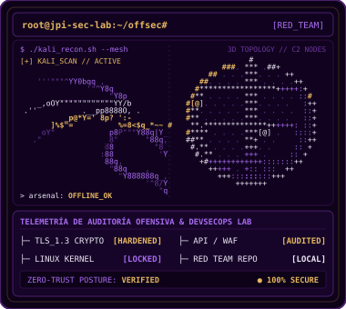

<div align="center">

<!-- BANNER PRINCIPAL: ARTE ASCII 3D EN TIEMPO REAL & STARFIELD -->


<br/>

<!-- TERMINAL ANIMADA EN DORADO (#e5b75f) -->
<a href="https://showroom-jpi.pages.dev/">
  
</a>

<br/>

<!-- BOTONERA DE ACCESO RÁPIDO -->
[](https://showroom-jpi.pages.dev/)
[](https://drive.google.com/drive/folders/1sUxWQmytzWyFzn57-jSNQy7WGgq7Asiq?usp=drive_link)
[](mailto:juanmgelp22@gmail.com)
[](#)

</div>

<br/>

---

## `⚡ // 00_MANIFIESTO: JUAN // Jπ STUDIO`

```ansi
┌──(jpi@cosmos-node)-[~/manifesto]
└─$ cat identity_core.txt
Soy Juan (Jπ). Combino el rigor analítico de la Física, las Matemáticas y la
Ciencia de Datos en la UNLP con la ingeniería de software a través de mi estudio Jπ Studio.
Diseño experiencias web inmersivas, visualizadores 3D y arquitecturas interactivas donde cada
animación, modelo matemático y flujo de datos responde con precisión física.
```

<br/>

---

## `🔭 // 01_PILARES_DISCIPLINARES & LABORATORIOS`

<!-- BLOQUE 1: FÍSICA AVANZADA, MATEMÁTICA & CIENCIA DE DATOS (UNLP) -->
<table width="100%">
  <tr>
    <td width="54%" valign="middle">
      <h3><code>🪐 01 // FÍSICA AVANZADA, MATEMÁTICA & DATA SCIENCE (UNLP)</code></h3>
      <p>
        Formación académica en la <b>Universidad Nacional de La Plata (UNLP)</b> centrada en el modelado físico-matemático del universo, sumando a partir de <b>2027</b> una segunda carrera enfocada en <b>Ciencia de Datos</b>.
      </p>
      <ul>
        <li>⚡ <b>Tópicos de Investigación & Estudio:</b> Electromagnetismo clásico, relatividad, óptica física, mecánica cuántica (efecto fotoeléctrico, dispersión de Compton), cálculo vectorial y álgebra lineal.</li>
        <li>📄 <b>Informes de Laboratorio (Formato Paper):</b> Producción de artículos técnicos en <code>LaTeX</code> con análisis estadístico, propagación de incertezas y contrastación experimental.</li>
        <li>🎓 <b>Clases de Consulta & Mentoría:</b> Resolución de problemas complejos y acompañamiento académico en física universitaria y análisis matemático.</li>
      </ul>
      <p>
        <a href="https://drive.google.com/drive/folders/1sUxWQmytzWyFzn57-jSNQy7WGgq7Asiq?usp=drive_link">
          
        </a>
        <a href="#">
          
        </a>
      </p>
    </td>
    <td width="46%" valign="middle" align="center">
      
    </td>
  </tr>
</table>

<br/>

<!-- BLOQUE 2: Jπ STUDIO — CREATIVE WEB, 3D & MOTION ARCHITECTURE -->
<table width="100%">
  <tr>
    <td width="54%" valign="middle">
      <h3><code>🚀 02 // Jπ STUDIO — INGENIERÍA WEB INMERSIVA, 3D & MOTION</code></h3>
      <p>
        Laboratorio creativo y estudio de desarrollo independiente especializado en experiencias digitales de autor, aplicaciones móviles y sistemas interactivos de alto impacto visual.
      </p>
      <ul>
        <li>✨ <b>Interactive Showroom (<a href="https://showroom-jpi.pages.dev/">showroom-jpi.pages.dev</a>):</b> Plataforma en vivo con presets web personalizables, prototipos de apps móviles, showcases de motion graphics y calculadora dinámica de presupuestos Built con <code>Astro</code>, <code>Tailwind CSS</code> y <code>Rive</code>.</li>
        <li>🧊 <b>WebGL & Visualización 3D en Tiempo Real:</b> Desarrollo de visores 3D interactivos con <code>Three.js / WebGL</code> optimizados para dispositivos móviles, integrados con mecánicas de scroll fluido (<code>Lenis</code>) y coreografías con <code>GSAP</code>.</li>
        <li>🤖 <b>AI-Driven Architecture & Workflows:</b> Orquestación de desarrollo y arquitectura con <code>Claude Code</code>, despliegues continuos y automatización mediante <code>n8n</code>.</li>
      </ul>
      <p>
        <a href="https://showroom-jpi.pages.dev/">
          
        </a>
        <a href="mailto:juanmgelp22@gmail.com">
          
        </a>
      </p>
    </td>
    <td width="46%" valign="middle" align="center">
      
    </td>
  </tr>
</table>

<br/>

<!-- BLOQUE 3: CIBERSEGURIDAD OFENSIVA & PENTESTING LAB -->
<table width="100%">
  <tr>
    <td width="54%" valign="middle">
      <h3><code>🛡️ 03 // CIBERSEGURIDAD OFENSIVA & PENTESTING LAB</code></h3>
      <p>
        Estudio metódico y técnico de seguridad informática desde la arquitectura de redes y el kernel hasta metodologías de reconocimiento, enumeración y pruebas de penetración.
      </p>
      <ul>
        <li>🗄️ <b>Repositorio Offline & Arsenal Técnico:</b> Construcción de un archivo local curado con herramientas de auditoría, scripts propios, documentación de vulnerabilidades y guías de estudio.</li>
        <li>🔐 <b>DevSecOps & Blindaje de Aplicaciones:</b> Aplicación de mentalidad ofensiva (<i>Red Teaming</i>) para auditar y asegurar cada API, servidor y aplicación web desplegada en <b>Jπ Studio</b>.</li>
        <li>💻 <b>Investigación en Entornos Linux:</b> Análisis de tráfico, criptografía aplicada, hardening de servidores y automatización en Bash/Python.</li>
      </ul>
      <p>
        
      </p>
    </td>
    <td width="46%" valign="middle" align="center">
      
    </td>
  </tr>
</table>

<br/>

---

## `🛠️ // 02_MATRIZ_DE_HERRAMIENTAS`

<div align="center">

| **Frontend & Creative Dev** | **3D, Física & Geo-Espacial** | **AI Engineering & Workflows** | **Ciencia, Datos & OffSec** |
| :---: | :---: | :---: | :---: |
|  |  |  |  |
|  |  |  |  |
|  |  |  |  |
|  |  |  |  |

</div>

<br/>

---

## `📊 // 03_TELEMETRÍA_DE_REPOSITORIOS (JuanGelp)`

<div align="center">
  
  
</div>

<br/>

<div align="center">

```ansi
══════════════════════════════════════════════════════════════════════════════════════════════
      JUAN // Jπ STUDIO  •  CREATIVE ARCHITECTURE, PHYSICS & OFFENSIVE SECURITY  •  LA PLATA   
══════════════════════════════════════════════════════════════════════════════════════════════
```

</div>
